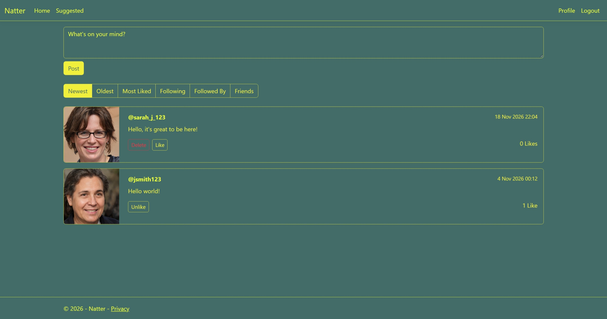
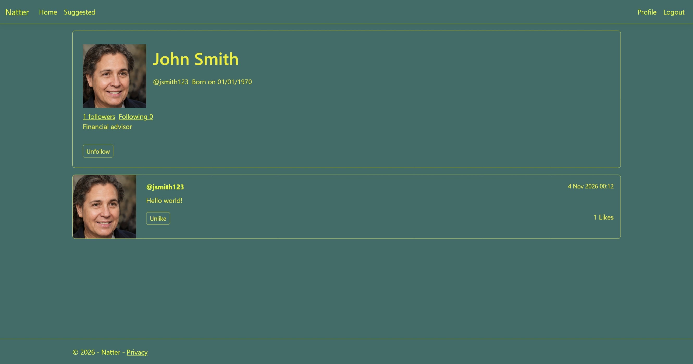
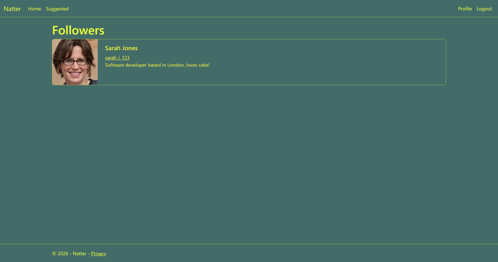

# Natter

I wanted to get more familiar with ASP.NET MVC, so I built a mini social network! At time of writing, it supports profile pages, following/followers, likes and feed ordering. Give it a try at https://n.reubenwaring.co.uk

|Homepage|Profile Page|Followers List (Per Profile)|
|---|---|---|
||||
